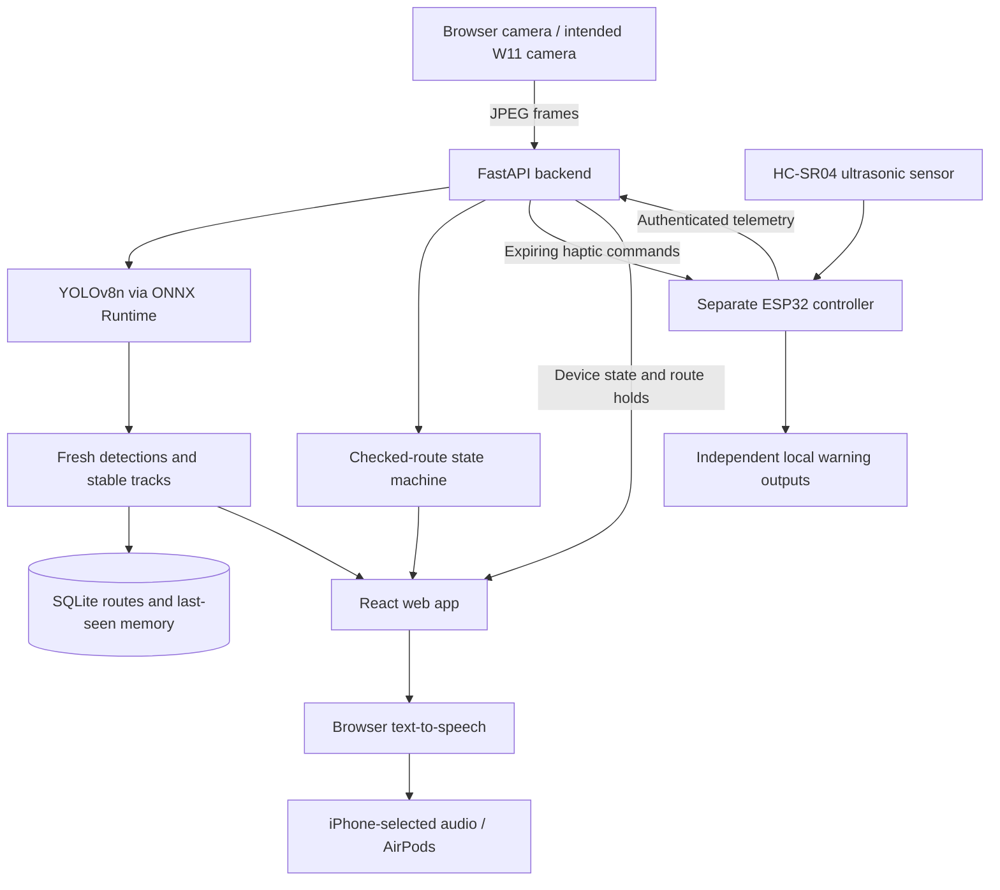

# STRIDE

### Object awareness, spoken guidance, and remembered places.

STRIDE is an assistive navigation prototype for blind and low-vision people. It combines a wearable camera, real-time object recognition, ultrasonic proximity sensing, spoken feedback, and saved routes to make nearby surroundings easier to understand.

The experience we are building is simple: hear what is in view, receive a warning when something is nearby, follow a familiar checked route, and recall where an object was last seen. AirPods provide a familiar audio interface; an independent ESP32 controller supports local proximity alerts without depending on the cloud.

**Hackathon status:** the repository contains the integrated FastAPI backend, React web app, real YOLO detector, persistent route/object memory, ESP32 firmware, and a Mac-assisted camera/sensor/voice demo. Software tests and local webcam measurements are documented below. Physical sensor calibration, W11 operation, actual AirPods audibility, and the complete hosted iPhone workflow are not established by those tests.

[Quick start](#quick-start) · [How it works](#how-it-works) · [Hardware](#hardware) · [Evidence](#testing-and-measured-results) · [Limitations](#current-limitations-and-next-steps)

## The problem

Identifying an object, noticing that something is too close, remembering a destination, and understanding the next route instruction are different tasks. A camera can recognize a chair without knowing its distance. A range sensor can report a nearby surface without knowing it is a chair. A useful assistive interface needs to keep these distinctions clear and communicate without overwhelming the user.

STRIDE brings these signals together around short audio messages, explicit route controls, and persistent memory. It is designed to complement existing mobility aids and user judgment. It has not been validated as a replacement for a cane, guide dog, or orientation and mobility training.

## What STRIDE does

| Capability | User experience | Implementation status |
| --- | --- | --- |
| Continuous object awareness | Bounding boxes and labels for supported objects; local audio such as “chair, ahead” or “cup, to the left” | Real YOLO inference and local Mac speech implemented |
| Nearby-obstacle warnings | Short proximity warnings; invalid or stale readings are treated as unknown | ESP32 firmware, USB voice bridge, and backend classification implemented; physical calibration pending |
| Checked-route guidance | Select a saved route, hear instructions, and explicitly confirm each checkpoint | Backend persistence and web controls implemented; tested with synthetic layouts |
| Saved destinations | Named routes with ordered checkpoints and landmarks | Route import, verification checks, listing, and selection implemented; no automatic route generation |
| Last-seen object memory | Recall an object's recorded time, source, and association with the last user-confirmed checkpoint | Stable-track recording, SQLite persistence, and memory display implemented |
| Voice through AirPods | System text-to-speech plays through the phone or Mac's selected audio output | Browser and Mac speech implemented; actual device routing/audibility requires human confirmation |
| Haptic route cues | Short left/right/straight/stop vibration patterns | Firmware and expiring command/ACK APIs implemented; physical driver/motor operation unverified |
| Accessible controls | Explicit Stop, adjustable text size and speech rate, high-contrast states, and named controls | Responsive UI and browser tests implemented; no formal accessibility certification |

**“Ahead” describes camera image position.** It does not establish depth or a safe walking direction. A checked route can instruct a right turn at a checkpoint; STRIDE does not infer a safe “move right around this chair” maneuver from a detection box and one forward range reading.

## How it works

### System architecture



This diagram shows the system design and implemented interfaces. The direct W11-to-hosted-backend path and complete physical phone/wearable workflow still require integration. Backend-authorized live object speech is also pending; the browser does not turn arbitrary detection metadata into narration.

The working development path is separate and explicit:

```text
Mac webcam OR prepared W11 LAN camera
                 ↓
         Local YOLO + box preview
                 ↓
       macOS speech → selected AirPods
                 ↑
ESP32 ultrasonic → USB → proximity-warning priority
```

The W11 LAN adapter and combined USB demo code are prepared; actual W11 frames and sensor measurements must be observed before claiming hardware operation. This path requires a Mac and does not represent a laptop-independent wearable.

### Perception and freshness

- **Model:** YOLOv8n, exported to ONNX, with 80 COCO object classes. Examples include people, chairs, bottles, cups, and vehicles.
- **Runtime:** ONNX Runtime on CPU, static `320 × 320` input, RGB letterboxing, confidence threshold `0.35`, and class-aware NMS at IoU `0.45`.
- **Tracking:** class/IoU matching provides stable track IDs; two observations are required before a track is eligible for memory or local object announcements.
- **Backpressure:** bounded frame storage and asynchronous inference favor current input rather than replaying a backlog.
- **Invalidation:** pause, stop, generation/source changes, and stale frames suppress obsolete results. Current-scene freshness is limited to one second; remote capture freshness requires trustworthy timing alignment.
- **Integrity:** the model manifest records labels, preprocessing, export versions, and checksums. A configured checksum mismatch fails closed.

OpenCV handles capture and image processing; YOLO performs recognition. Gemini is an optional future enhancement, not a dependency of the current detection or voice loop.

### Proximity and route control

The backend classifies fresh valid range readings as **danger at ≤50 cm**, **caution at ≤100 cm**, or **clear above that range**, with recovery hysteresis. Invalid, unsupported, absent, or stale measurements become **unknown**.

Once a controller is paired, danger, caution, or unknown sensing holds navigation and invalidates routine guidance. Recovery requires **three consecutive fresh valid readings above 105 cm**, then returns navigation to **paused**. The user must explicitly resume; distance changes never confirm a checkpoint or prove a safe path.

The ESP32's independent local warning bands are initially 30/60/100 cm and use a three-reading median. These differ from the backend's conservative route holds and are uncalibrated engineering defaults. Sensor filtering and communication introduce latency that must be measured on hardware.

### Destinations and memory

Saved destinations are manually defined routes with names, instructions, landmarks, and ordered checkpoints. Imported routes start **unchecked** and cannot provide guidance until a person verifies the actual layout. The UI supports Start, Confirm Arrival, Repeat, Pause, Resume, and Stop. Repeated requests use action IDs and revision checks to prevent accidental double advancement.

Route progress and history persist in SQLite. On server restart, active navigation becomes paused and previous guidance is invalidated.

Object memory records **last-seen observations**, not current object locations. It retains time, provenance, track information, and the last checkpoint confirmed before that observation. It does not automatically map a building, locate the wearer, or calculate a return path to an object.

### Speech and feedback priority

The web app uses browser `SpeechSynthesis`; the local Mac demo uses macOS `say`. No cloud TTS service or custom cloned voice is required. AirPods pair to the **phone or Mac**, not directly to either ESP32. The operating system chooses the output destination; UI readiness cannot prove that audio was heard through AirPods.

The browser scheduler prioritizes urgent warnings and sensing faults above route cues and routine observations. It bounds the queue, deduplicates events, checks expiry/current state, and cancels obsolete speech. Audio requires an explicit user gesture in the browser.

The local `--sensor-port` demo interrupts object narration for proximity or sensing-fault warnings. Its messages include “Stop. Object nearby” and “Distance sensing unavailable. Stop and check.” It does not issue avoidance directions. The complete backend-authorized object/route/fault speech pipeline remains an integration task.

## Quick start

### Prerequisites

- Python **3.11** for the documented vision setup and [uv](https://docs.astral.sh/uv/).
- Node.js **24** was used for frontend acceptance tests; pnpm **10.34.3**.
- A webcam for the first visual demo. macOS is required for the local `say` audio option.
- Arduino CLI, Arduino-ESP32 **3.3.2**, and ArduinoJson **7.4.2** for firmware builds.
- A generated `models/yolov8n.onnx` and its matching `models/manifest.json`. Model binaries are intentionally excluded from Git.

From the repository root:

```sh
git clone https://github.com/adhyannsingal/stride.git
cd stride
uv venv --python 3.11 .venv-phase3
uv pip install --python .venv-phase3/bin/python -r backend_phase3/requirements-vision-dev.txt
```

**Prepare the model once**, in a separate export environment:

```sh
uv venv --python 3.11 .venv-model
uv pip install --python .venv-model/bin/python -r app/vision/requirements-dev.txt
PYTHONPATH=. .venv-model/bin/python scripts/export_model.py
```

The export script downloads a pinned checkpoint, verifies its checksum, and writes the ONNX artifact and matching manifest. Alternatively, supply an existing verified artifact/manifest pair. Export tooling is separate from the serving environment.

### 1. See and hear real objects

```sh
PYTHONPATH=. .venv-phase3/bin/python scripts/preview_live.py --speak
```

On macOS, select AirPods as system audio output if desired. For boxes without audio, omit `--speak`. The prepared Mac launcher is also available:

```sh
./Start_Stride_Demo.command
```

| Key | Action |
| --- | --- |
| `P` | Pause/resume the camera |
| `Q` or `Esc` | Quit and release camera/audio |
| `+` / `-` | Adjust diagnostic confidence only |

The preview does not upload images or populate backend memory. Close it before another application takes ownership of the same camera.

### 2. Run the backend and web app

**Terminal A — backend:** these credentials are local examples only.

```sh
export STRIDE_LOCAL_DEV=true
export STRIDE_SESSION_TOKENS='{"judge-demo":"local-demo-only"}'
export STRIDE_FRONTEND_ORIGINS='["http://127.0.0.1:8443"]'
export STRIDE_RECORD_STABLE_SIGHTINGS=true
export STRIDE_DETECTOR_FACTORY=app.vision.phase2:build_detector
PYTHONPATH=.:backend_phase3 .venv-phase3/bin/python -m uvicorn stride_backend.main:create_app --factory --host 127.0.0.1 --port 8000 --workers 1
```

**Terminal B — frontend:**

```sh
cd frontend
npx pnpm@10.34.3 install --frozen-lockfile
npx pnpm@10.34.3 run dev --host 127.0.0.1
```

Open **http://127.0.0.1:8443** and connect using session `judge-demo` and token `local-demo-only`. The development server proxies API requests to port 8000. Swagger/API documentation is at **http://127.0.0.1:8000/docs**.

Use the explicitly labeled **Demo data** mode to explore the interface without hardware; it is simulated. In real mode, use one camera producer per session. Viewer mode must not start another camera. Built-in demonstration routes remain unchecked until their actual layout is verified.

For iPhone access, `127.0.0.1` refers to the phone itself. A reachable, correctly configured HTTPS origin is required for the intended phone/camera/cookie workflow; the loopback commands above do not deploy it. Browser capture requires permission and an explicit Start action.

### 3. Add ultrasonic sensing and voice

Follow the [wiring guide](Stride_Hardware_Wiring_Guide.md) and [deadline bring-up instructions](handoff/thirty-minute-hardware-demo.md) before powering or flashing hardware. Confirm the board and actual USB port.

```sh
uv pip install --python .venv-phase3/bin/python -r scripts/requirements-hardware.txt
arduino-cli compile --fqbn esp32:esp32:esp32 --build-property 'compiler.cpp.extra_flags=-DSTRIDE_SELF_TEST=1' --build-path /tmp/stride-bench-sensor firmware/feedback
```

Sensor-only mode keeps motor/buzzer outputs off and disables networking. After checking the target, wiring, and port:

```sh
arduino-cli upload --fqbn esp32:esp32:esp32 --port ACTUAL_USB_PORT --input-dir /tmp/stride-bench-sensor firmware/feedback
PYTHONPATH=. .venv-phase3/bin/python scripts/serial_voice.py --port ACTUAL_USB_PORT
```

For the combined local camera/sensor/audio demo, stop the standalone serial bridge first, then:

```sh
PYTHONPATH=. .venv-phase3/bin/python scripts/preview_live.py --sensor-port ACTUAL_USB_PORT
```

Only one process may own the serial port. This is a Mac-assisted diagnostic; its camera and sensor polling share the UI loop, so independent warning latency is not guaranteed. Physical acceptance requires measured distances, real audible warnings, no-echo/disconnection checks, and recovery tests.

### 4. Use the W11 camera as a local source

A vendor-matched Meshnology W11 camera-only preparation script and HTTP capture adapter are included. Follow [W11 local demo instructions](handoff/w11-local-demo.md) to identify the board, configure private Wi-Fi, build/flash the correct target, and obtain its actual LAN IP.

```sh
./Start_Stride_Demo.command --camera-url http://ACTUAL_CAMERA_LAN_IP/capture
```

The prepared camera reports frame age; missing timing metadata allows visual diagnostics but suppresses current-scene object speech. Do not flash the hosted uploader's syntax-only binary. The original hosted uploader still needs camera-state and multipart API compatibility work.

### 5. Add a saved destination

Copy [the unchecked route example](qa/routes/example-unchecked.json), replace its placeholders with a real supervised layout, and choose a unique ID:

```sh
PYTHONPATH=.:backend_phase3 STRIDE_LOCAL_DEV=true .venv-phase3/bin/python scripts/import_saved_route.py /path/to/your-route.json
```

Only **after physically verifying the route**, mark that route checked:

```sh
PYTHONPATH=.:backend_phase3 STRIDE_LOCAL_DEV=true .venv-phase3/bin/python -m stride_backend.route_store check YOUR_ROUTE_ID --note 'Actual verification details'
```

Use the same working directory/database path as the running backend. Importing never trusts supplied verification flags; duplicate route IDs are rejected. The default database is `data/stride.sqlite3`.

## Hardware

| Component | Role |
| --- | --- |
| Meshnology W11 ESP32-S3 with OV3660 | Intended wearable camera; vendor-matched local camera build prepared |
| Separate ESP32 DevKit / ESP32-WROOM | Ultrasonic sampling and independent feedback controller |
| HC-SR04 | Forward range measurement; does not identify objects or map free space |
| AirPods with iPhone or Mac | Selected system audio output for speech |
| 3 V vibration motor | Optional local/route patterns through a protected driver |
| Optional switched buzzer | Audible local patterns, including the current firmware's unknown-sensor beep |
| USB supply / power bank | Bench or wearable power, with verified rails and current capacity |

**Electrical requirements:** HC-SR04 ECHO must pass through a verified voltage divider before GPIO19. A motor must not connect directly to a GPIO or 5 V; it requires a regulated 3 V supply, suitable driver, flyback protection, and common ground. Firmware uses GPIO18 TRIG, GPIO19 divided ECHO, GPIO23 buzzer driver, and GPIO25 motor driver on the separate DevKit. Verify physical pin labels and board identity before connection.

The current motor-only configuration has no distinct unknown-sensor vibration pattern; without a buzzer, an inactive motor is not proof of clear space. Full circuits, power guidance, and staged sensor/buzzer/motor checks are in the [hardware wiring guide](Stride_Hardware_Wiring_Guide.md) and [firmware README](firmware/README.md).

## Technology stack

| Layer | Technology |
| --- | --- |
| Web interface | React 19, TypeScript, Vite, Tailwind CSS, Figma Astra UI |
| API and validation | FastAPI, Pydantic, Uvicorn |
| Object recognition | YOLOv8n, ONNX Runtime, NumPy |
| Capture and image handling | OpenCV and Pillow |
| Persistence | SQLite |
| Embedded controller | Arduino C++ / FreeRTOS on ESP32 |
| Voice | Browser SpeechSynthesis and macOS `say` |
| Verification | pytest, Node tests, browser acceptance checks, portable C++ checks, Arduino compilation |

## API overview

The active integrated application is **`backend_phase3/stride_backend`**, currently version **0.4.0**. Despite the directory name, it contains Phases 1–4. `backend_phase1/` and `backend_phase2/` are earlier milestones; do not run them alongside it or put multiple backend directories on `PYTHONPATH`.

| Endpoint | Purpose |
| --- | --- |
| `GET /health`, `GET /time` | Basic health and server time |
| `POST /auth/session` | Exchange provisioned UI credentials for an HttpOnly session cookie |
| `POST /frame` | Authenticated multipart JPEG and frame metadata upload |
| `POST /vision` | Start, pause, resume, or terminally stop a vision session |
| `GET /vision/latest`, `GET /status` | Vision results, freshness, and backend/vision status |
| `GET /routes`, `POST /route` | List saved routes and control checkpoint navigation |
| `GET /memory` | Route progress/history and last-seen object observations |
| `POST /device/pair` | Explicitly associate an allowlisted controller with its authorized session |
| `POST /telemetry` | Receive authenticated controller measurements |
| `GET /devices/{device_id}/commands` | Retrieve one-shot, short-lived haptic cues |
| `POST /device/ack` | Record command receipt/execution/rejection/expiry reports |
| `GET /device/status` | Controller contact, measurement freshness, and command audit |

Device aliases and complete schemas are documented in [DEVICE_INTEGRATION.md](backend_phase3/DEVICE_INTEGRATION.md) and Swagger. Later route actions require `navigation_id` and `expected_revision`; exact action retries retain the same action ID and payload. Terminal vision Stop requires a newly provisioned session for another run.

## Testing and measured results

These results describe specific software runs and local measurements, not a clinical or real-world mobility evaluation.

| Check | Recorded evidence | Scope |
| --- | --- | --- |
| Integrated backend | **262 tests passed**, including opt-in real detector test | Authentication, vision lifecycle, routes, memory, telemetry, obstacle holds, commands/ACKs |
| Vision/integration | **58 tests passed** on the current checkout with local model/fixtures available | Model decoding, freshness, source changes, tracking, memory, speech policies, USB and HTTP adapters |
| Frontend regression | **55 tests passed** | Speech/camera controllers, state recovery, policy and API handling |
| Actual backend/frontend checks | **13 HTTP checks, 15 browser workflow checks, 5 recovery checks passed** | Temporary DB, synthetic routes, mocked browser media/speech; no physical phone or AirPods claim |
| Firmware | ESP32 controller compiled; camera syntax/gating and vendor-matched W11 build documented | Compilation, not physical execution |
| Obstacle scenario | Simulated close obstacle blocks route; stale/invalid readings keep it blocked; clear samples lead to paused; explicit Resume restores guidance | Real application with synthetic telemetry |

The latest recorded **60-second local webcam → HTTP backend → YOLO** run returned **10.85 unique results/second**, with **56 ms p95 capture-to-completion** and **zero HTTP errors**. It used a trusted shared OS clock and local CPU inference. These figures are not W11, hosted, or camera-to-AirPods latency measurements, and they do not measure detection accuracy. An earlier run returned 6.58 results/second with 193 ms p95, illustrating configuration/environment dependence.

Evidence: [latest webcam measurement](qa/current-webcam-http.json), [earlier measurement](qa/phase2-webcam-http.json), [frontend QA](qa/frontend.md), [simulated obstacle trace](qa/phase4-obstacle-cycle.json), [firmware compile record](qa/phase4-firmware-compile.txt), and [quality evaluation workflow](qa/quality/README.md). Human-reviewed held-out detection accuracy remains unmeasured.

Reproduce component checks from the repository root:

```sh
PYTHONPATH=.:backend_phase3 .venv-phase3/bin/python -m pytest tests/vision tests/integration -q
(cd backend_phase3 && PYTHONPATH=..:. ../.venv-phase3/bin/python -m pytest -q)
PYTHONPATH=.:backend_phase3 .venv-phase3/bin/python scripts/simulate_obstacle_cycle.py
(cd frontend && npx pnpm@10.34.3 test && npx pnpm@10.34.3 run typecheck && npx pnpm@10.34.3 run build)
```

Real-model fixture tests need the generated model and an explicitly supplied image. To enable the backend's real detector check, set `STRIDE_INTEGRATION_DETECTOR_FACTORY=app.vision.phase2:build_detector` and `STRIDE_INTEGRATION_JPEG=/absolute/path/to/test.jpg`. Missing optional fixtures cause skips, not evidence of model execution. Browser acceptance setup is documented in [frontend QA](qa/frontend.md).

## Security, privacy, and deployment

- UI, camera, and controller credentials have separate roles; controllers are explicitly provisioned and paired.
- Frame/body sizes, queues, sessions, telemetry history, and command retention are bounded.
- Boot identity, increasing sequence numbers, action IDs, revisions, and TTLs prevent obsolete requests from becoming current actions.
- The preview does not record images/audio. SQLite stores routes and observation metadata, not image blobs or authentication secrets.
- Private images, model binaries, database files, `.env` files, and firmware secrets are excluded from Git. Diagnostic tools can explicitly capture private evaluation images; those are a separate opt-in workflow.
- Deploy one backend process/replica with one Uvicorn worker, persistent writable SQLite storage, a verified model/manifest pair, and correctly provisioned secrets.
- Serve the frontend and API through one HTTPS origin. Production must disable `STRIDE_LOCAL_DEV`, enforce allowed origins and secure cookies, and use verified TLS for controllers.

No public hosted deployment is established by the local launch commands. The W11 camera-only LAN example serves local HTTP images for development; it is not the authenticated production transport.

## Repository guide

```text
frontend/               Primary React web app and browser/contract tests
backend_phase3/         Active integrated FastAPI backend, routes, memory, devices
app/vision/             YOLO model adapter, tracking, capture, local audio policies
firmware/feedback/      ESP32 ultrasonic and independent feedback firmware
firmware/camera/        Original gated W11 uploader; hosted compatibility pending
models/manifest.json    Labels, preprocessing, provenance, and model checksums
scripts/                Preview, W11 preparation, model export, diagnostics, imports
qa/                     Measurements, compile records, evaluation and QA reports
handoff/                Detailed integration contracts and bring-up instructions
contracts/              Original design contracts; consult executable API for changes
web/                    Earlier frontend scaffold; frontend/ is the primary app
backend_phase1/, backend_phase2/  Historical backend milestones
```

## Current limitations and next steps

1. **Complete physical bring-up:** verify board identity, voltage levels, real ranges, camera orientation, motor drivers, offline warnings, and measured alert latency.
2. **Finish the hosted wearable path:** resolve W11 upload/producer-selection compatibility, deploy the integrated app, and prove one camera source feeding the phone viewer.
3. **Complete voice integration:** connect stabilized backend-authorized object events to the existing speech scheduler and verify real iPhone/AirPods interruption and reconnect behavior.
4. **Evaluate perception:** annotate independent held-out scenes and report misses/false positives across lighting, object scale, motion, and occlusion.
5. **Study usability with the intended users:** evaluate comprehensibility, cognitive load, accessibility, comfort, and alert patterns with appropriate supervision.

STRIDE does not currently provide automatic mapping, GPS navigation, arbitrary-origin destination planning, reliable drop-off/stair detection, metric camera depth, or validated autonomous avoidance. One forward ultrasonic cone cannot establish free space to either side or associate its range with a specific recognized object. Missing detections and quiet outputs never prove that a path is clear.

**Demonstration boundary:** use a controlled, physically checked route with a sighted spotter. Independent blind walking and road crossings are outside the validated scope of this prototype.

## Credits and licensing

STRIDE combines original application/firmware work with pretrained Ultralytics YOLOv8n weights, ONNX Runtime, OpenCV, FastAPI, React, and Figma/Astra interface tooling. Model provenance, source URLs, and hashes are recorded in [the manifest](models/manifest.json). Upstream YOLO licensing information is linked there; dependency and model license obligations still apply. This repository does not currently declare a project-wide license.
