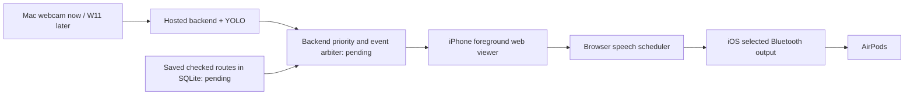

# Next delivery plan — quality, AirPods and saved routes

> Current implementation update: [Phase 3 delivery and remaining work](four-hour-delivery.md). This document preserves earlier evidence; its Phase 2 route/memory gaps are superseded by Phase 3.

Current evidence baseline: main ec837a1 combined backend/YOLO; quality evaluator
273fdd0; obsolete root Phase_1 removed in 46c1976. This plan follows the actual
Phase 2 implementation, not an assumption that every planned endpoint exists.
Frontend reviewed at feature/frontend 0f9500d, whose handoff says do not merge to
main. Its source was inspected and tested in a temporary copy, not overwritten.
No messages were sent to teammates/services; this is the concrete team handoff.

## Current facts and actions already completed

- Real local HTTP webcam → backend → YOLO: 6.58 results/s, capture-to-completion
  p95 193 ms over 60 s, zero HTTP errors. This is not a hosted/audio result.
- 12 private webcam review JPEGs captured under ignored
  qa/private/initial-tuning-review/. All annotations remain reviewed=false,
  complete_for_labels=false. No accuracy result or runtime threshold change yet.
- Quality evaluator and confidence sweep implemented; tests reject unreviewed
  labels and tuning/validation leakage. Separate held-out scenes still needed.
- Speech review reproduced four failures in Agent 2's scheduler. Proposed patch
  passes all five focused tests on a temporary copy. NOT applied to Agent 2's
  branch and NOT tested as audible speech on iPhone/AirPods.
- Existing backend inventory: no GET/POST /routes, POST /route, GET /memory or
  GET /memory/export. See qa/navigation-readiness.json. Frontend route/memory
  examples are fixtures, not server persistence.
- Root Phase_1 was deleted by a normal Git commit. backend_phase1 executable code
  and original contributor history are preserved; no history was rewritten.

## Work order and completion gates

Work estimates below are timeboxes for the next available work blocks, not a new
six-hour clock or a promise to finish before an unknown submission deadline.
Agent 1/2 implementation can proceed alongside Agent 3's reviewed evaluation.
Do not serialize the entire team behind accuracy collection or hardware arrival.

| Order | Work block | Owner | Concrete implementation | Exit evidence |
| --- | --- | --- | --- | --- |
| 1 — now | Quality review, approximately 20–30 min once human ready | Agent 3 + Adhyann | Review the private photos, annotate all target objects and negatives; capture a distinct held-out scene/session; sweep .25/.35/.45/.55 | Per-class misses/false positives on held-out images; no improvement claim from auto-labels |
| 2 — next software block | Backend/frontend contract convergence, approximately 20–30 min | Agent 1 + Agent 2, Agent 3 regression | Choose/document one public auth/session/frame/box contract; adapt the existing API layer, not a second app; explicit capture vs viewer roles | Real UI login/upload/results works; viewer does not take over camera; no fixture fallback |
| 3 — same software block | Speech patch + first AirPods smoke, approximately 10 min after a reachable page exists | Agent 2 + human, Agent 3 tests | Apply/review speech patch; user-gesture test; pair/select AirPods on iPhone | Human hears test phrase through actual AirPods, Stop cancels; browser/device versions recorded |
| 4 — parallel backend priority | Saved routes + route progress persistence, approximately 30–45 min initial vertical slice | Agent 1 | SQLite route definitions/versioned checkpoints/progress/action ledger; existing /routes, /route, /memory contract | Create/select a route, confirm once, repeat without advance, pause/stop, reload/restart persistence |
| 5 — before live announcements | Central feedback arbitration + verified remote freshness | Agent 1 with Agent 3 test harness; Agent 2 playback | Sensor stop > fault > route > observation; stable IDs/expiry shared across status/latest; explicit producer binding/clock verification | Old/unknown capture cannot become current speech; urgent cancels queued routine output; loss never means clear |
| 6 — before assembly | Hosted same-origin phone rehearsal | Agent 1 hosting, Agent 2 viewer, Agent 3 measurement | Mac capture + iPhone viewer, same session, HTTPS, real YOLO, real event playback | 60 s rate/age evidence; actual iPhone speech; no duplicate narration or hidden source takeover |
| 7 — parts arrive | Staged physical bring-up | Human Adhyann + Agent 3 | Rails/divider → sensor → buzzer → protected regulated 3 V motor → verified W11 → combined power | Measured ranges/patterns/offline alerts; verified pins; no fabricated hardware pass |
| 8 — release gate | Controlled checked-route demonstration | All owners + sighted spotter | Follow a physically checked route with explicit confirmations, local alert and fresh object-awareness tests | Route progress/actions, physical output, misses, source and timing all recorded honestly |

If a timebox runs over, finish the working vertical slice and cut optional Gemini,
GPS import, voice input and cosmetic work. Do not cut current-frame invalidation,
local warning independence, route confirmation or honest source/health labels.

## AirPods: connection, architecture and when

AirPods pair with **the iPhone**, not with W11, DevKit or the hosted server. iOS
selects the audio output. The web app uses ordinary browser speechSynthesis;
it cannot force or reliably verify that the selected destination is AirPods.
Show "speech enabled/ready", not an invented "AirPods connected" state.

Target flow (parts marked pending are not implemented by this plan):

Do the first audio-only test **before hardware arrives**, as soon as the actual
frontend is reachable on iPhone. It needs neither a camera upload nor a completed
route engine. Full live/route audio follows once the backend supplies authorized
events. Final W11/glasses audio is a separate test after camera bring-up.

1. Pair AirPods through iPhone Bluetooth using Apple's instructions for the exact
   model. Select them through the playback destination control/Control Center.
2. Open the frontend on iPhone as viewer/audio. Join the same authorized session
   as Mac capture. Do not start the phone camera or let viewer login change source.
3. Tap Enable/test audio; confirm the test phrase is heard in AirPods, not only
   shown in UI. Keep the page foreground/unlocked for the web implementation.
4. Verify duplicate events speak once, expired queued observations are dropped,
   urgent events cancel current and queued routine speech, and Stop/page hide/
   offline state cancel playback. Record actual audible behavior separately from
   scheduler unit tests. Test Bluetooth disconnection/fallback and iOS interruption.
5. For integrated checks: a checked-route instruction and a real stable object
   event go through the same backend arbiter/scheduler. Current YOLO Phase 2 plugin
   deliberately emits no final speech until that priority integration exists.
6. When sensor arrives, replace labeled simulated urgent events with real fresh
   telemetry. Offline local buzzer/motor must still work; do not claim cloud speech
   is guaranteed to follow an offline sensor instantaneously.

Apple output selection reference:
https://support.apple.com/guide/iphone/play-audio-iphone-a-bluetooth-accessory-iph01b6ea9a3/ios
Speech API references:
https://developer.mozilla.org/en-US/docs/Web/API/SpeechSynthesis/speak
https://developer.mozilla.org/en-US/docs/Web/API/SpeechSynthesis/cancel

A development LAN/preview/tunnel page can test audio, but is not proof of the
final hosted, laptop-independent runtime. Final camera permissions/cookies/deploy
must use the actual agreed same-origin HTTPS setup.

## Saved plans/routes: still core, currently not implemented server-side

Saved routes mean human-checked sequences of checkpoints with spoken instructions,
not automatic localization, a video recording of travel or an AI-generated safe
path. Example structure: named route, stable route ID/version, ordered checkpoint
IDs, human-written instructions, allowed motor pattern and separately checked
return instructions. A sample route stays explicitly illustrative until checked.

Agent 1's smallest complete vertical slice:

1. Persist route definitions, ordered steps, route version, progress and accepted
   action IDs/events in SQLite at the host's configured durable path. Do not
   persist raw camera images, pending motor cues or secrets in route data.
2. Implement POST/GET /routes and POST /route actions start/confirm/repeat/pause/
   resume/stop; expose authoritative progress through /status. Agent 2 renders it
   without incrementing local checkpoint counters or treating fixtures as saved.
3. Confirm advances one checkpoint exactly once per action ID. Repeat creates one
   new authorized speech event but does not advance. Paused/blocked/unknown sensor
   state cannot advance hardware navigation. Final confirmation completes once.
4. Page reload restores server progress. Application restart preserves saved
   routes/progress on the same database while expiring old commands/events. Phase
   2 vision Stop is terminal; agree new-session versus pause/resume semantics so
   frontend does not call resume on a terminally stopped vision session.
5. Store separately checked return instructions. Reversing a list does not
   establish correct return turns. Add checked/readiness metadata through a shared
   schema update before presenting a route as ready for physical use.
6. Expose memory/export for routes and progress, and later eligible object
   sightings with capture age/source and the last confirmed checkpoint. Historical
   sightings must never be described as a current guaranteed location.
7. If host disk is ephemeral, label persistence as deployment-local and export
   before redeploy. Browser localStorage is not the authoritative route database.

Acceptance: save → restart → reload; start → duplicate confirm advances once;
repeat never advances; pause blocks confirm; urgent warning cancels direction;
resume needs explicit action/fresh state; stop cannot replay; export/import does
not restore pending motor commands. These tests are not currently passing because
those endpoints/services do not yet exist. Do not call frontend fixtures Route Memory.

## Exact integration requests, without overlapping owners

Agent 1: route persistence, shared events/freshness/producer binding and deployment.
Keep one Phase 2 app/worker. Its actual auth/session/multipart/bbox contract is
mapped in handoff/backend-vision-integration.md; reconcile it with Agent 2 in one
API adapter or one reviewed backend migration, not parallel compatibility apps.

Agent 2: review/apply handoff/frontend-speech-fixes.patch on the frontend branch,
run the five regressions plus its existing controller/type/build checks, adapt
API calls to the agreed real backend and conduct the actual phone/AirPods test.
The branch's explicit "do not merge" instruction is preserved; no unilateral UI
merge or design rewrite was performed. See handoff/audio-regression-review.md.

Agent 3: private scene review/evaluation, detector tuning based on results, fault
regressions and real integration measurements; firmware/protocol and physical
support as soon as board facts/parts are available. No custom training or a new
native iOS app is required for the current slice.
